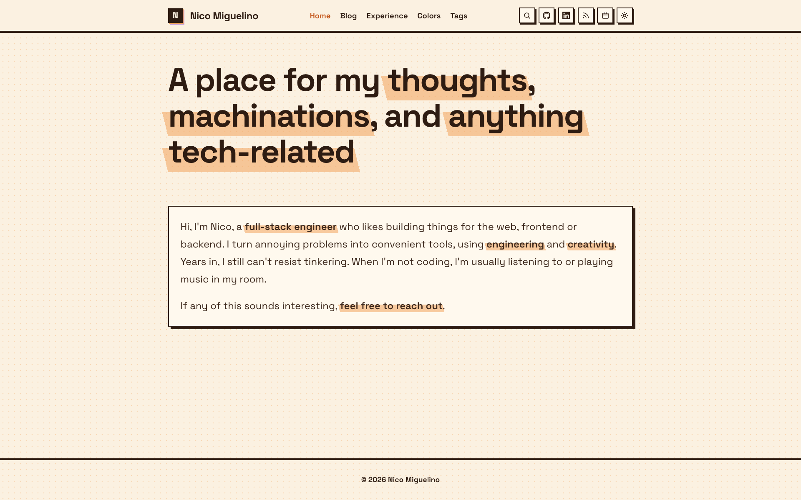
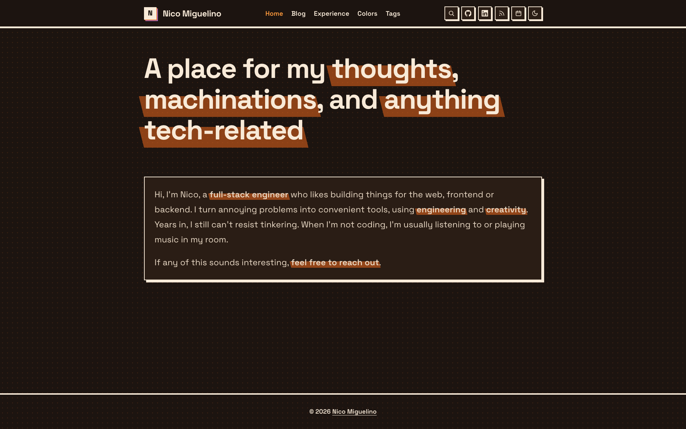
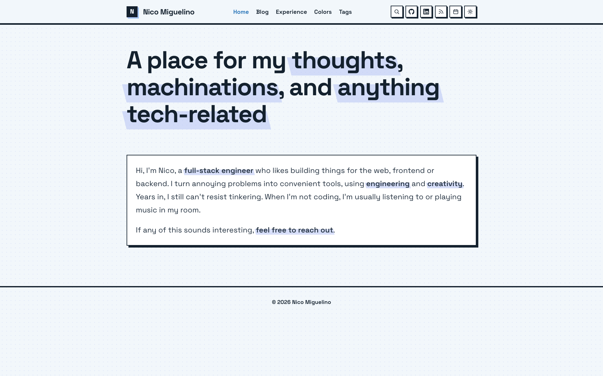
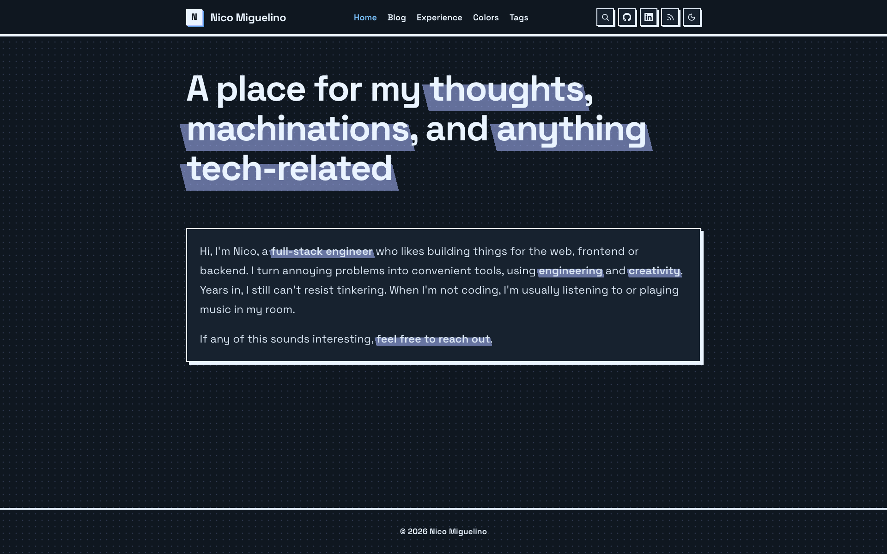
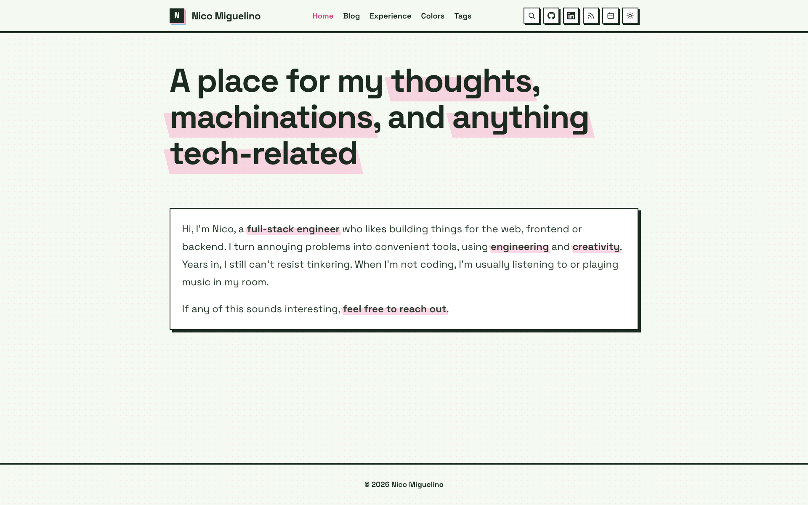
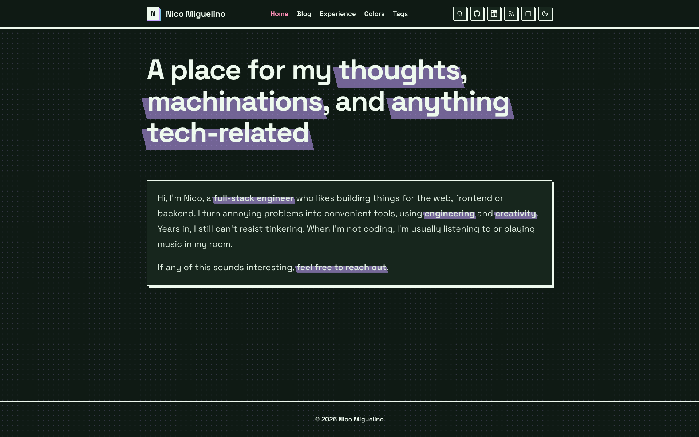
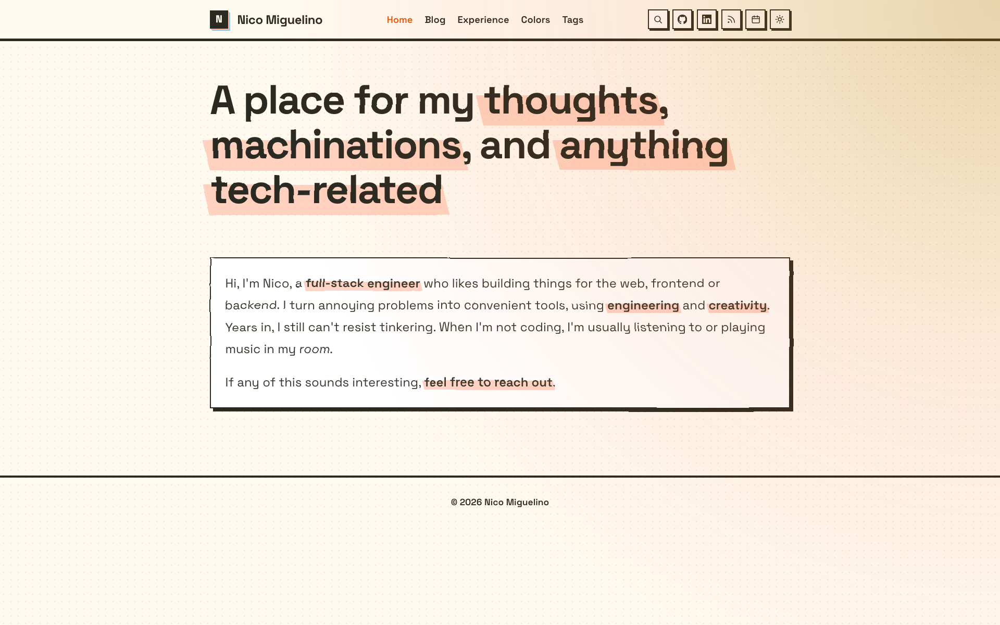
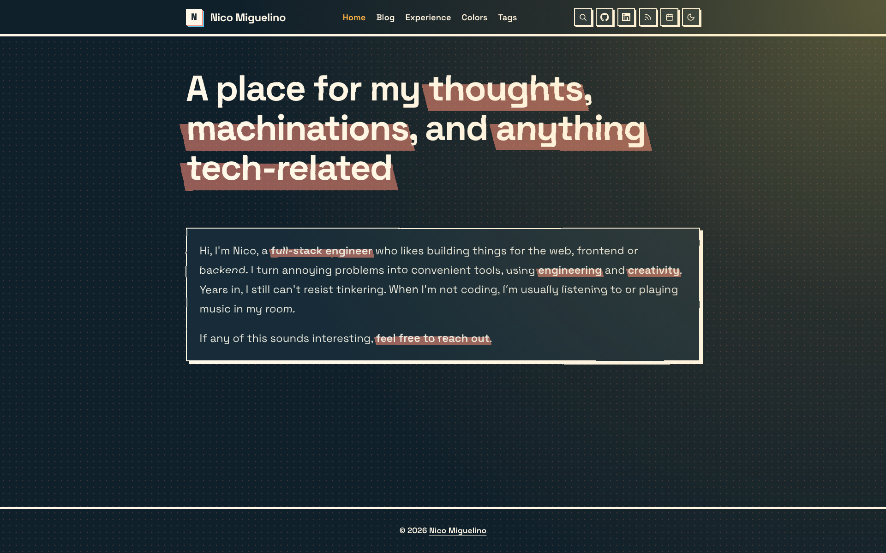

# Nico Miguelino

## Getting started

Clone the repo:

```sh
git clone git@github.com:nicomiguelino/nicomiguelino.github.io.git
cd nicomiguelino.github.io
```

If you use Claude Code, install the project plugin once:

```sh
claude plugin install nicomiguelino@nicomiguelino --scope project
```

Then install and run:

```sh
bun install
bun run dev           # dev server on :4321
bun run build         # production build
bun run preview       # preview the production build
bun run check         # astro type checking
bun run lint:check    # lint with ESLint
bun run lint:fix      # lint and apply safe fixes
bun run format:check  # check formatting with Prettier
bun run format:fix    # format files with Prettier
bun run test:e2e      # Playwright E2E and screenshot tests
```

> [!NOTE]
> `bun install` also sets up a Husky pre-commit hook that runs `lint:check`, `format:check`, and `check`. Fix failures before committing.

## Seasonal theme

The site switches palettes by date. Every family has a light and a dark variant, defined in `src/styles/palettes.css`:

- `neon-*`: not tied to a date, only available from the theme picker
- `autumn-*`: used from Sept 22 to Dec 21
- `winter-*`: used from Dec 22 to Mar 19
- `spring-*`: used from Mar 20 to Jun 20
- `summer-*`: used from Jun 21 to Sept 21

|        | Light                                              | Dark                                             |
| ------ | -------------------------------------------------- | ------------------------------------------------ |
| Autumn |  |  |
| Winter |  |  |
| Spring |  |  |
| Summer |  |  |

How it works:

- The family is picked from the visitor's local date on every page load, so no rebuild is needed when a season starts or ends.
- The mode (light or dark) comes from the theme toggle, falling back to `prefers-color-scheme`. Only the mode is stored (`site-mode` in `localStorage`), so a saved preference carries across seasons.
- The legacy `site-palette` value is migrated to `site-mode` and removed.
- `initializePalette()` in `src/lib/palette.ts` sets `data-palette` on `<html>`. `Layout.astro` calls it from `<head>`, and `body` stays hidden until the attribute is set (visible when scripting is off) to avoid a flash of the wrong colors.
- The theme toggle switches between light and dark within the active family.
- The theme picker in the navbar (before the light/dark toggle) overrides the date: Automatic (follow the date, the default), Autumn, Winter, Spring, Summer (under a "Seasons" divider), or Neon (under an "Other" divider). The choice is stored in `localStorage` as `site-theme` (removed for Automatic), and the matching falling effect follows it.

Autumn, winter and spring each have a falling effect on the home page (`FallingLeaves`, `FallingSnow`, `FallingPetals`). Summer has two ambient effects instead: `HeatShimmer` (an SVG displacement filter that makes the page content shimmer) and `Sunlight` (a pulsing warm glow in the top-right corner). Every effect is shown only under its palettes and when `prefers-reduced-motion` allows it.

To change the dates, edit `seasons` in `PALETTE_CONFIG` (`MMDD` numbers, inclusive; a range with `start` after `end` wraps the new year). To add a season, add it to `THEME_CHOICES` and the picker options in `src/components/header/ThemePicker.astro`, then add `[data-palette='<name>-light']` and `<name>-dark` blocks to `palettes.css`, add its name to `PaletteFamily`, and add its range to `seasons`.

To preview a season, set it in the browser console, e.g. `document.documentElement.dataset.palette = 'autumn-dark'`.

## Testing

Tests use [Playwright](https://playwright.dev) and live in `src/tests/`:

- `src/tests/e2e/`: behavior checks, e.g. the home page title
- `src/tests/screenshots/`: captures a screenshot of each page, one spec per page

Set up once per machine:

```sh
bunx playwright install chromium
```

Then build and run. Playwright serves the production build with `astro preview` on port 4322, so it never collides with the dev server on :4321:

```sh
bun run build
bun run test:e2e                                         # everything
bunx playwright test src/tests/e2e                       # E2E only
bunx playwright test src/tests/screenshots               # screenshots only
bunx playwright test src/tests/screenshots/blog.spec.ts  # one page
bunx playwright test --ui                                # interactive runner
bunx playwright show-report                              # open the last HTML report
```

### Screenshots

- Every page is captured at 1920x1200 in light and dark. The home page is also captured in autumn, winter and spring.
- The clock is pinned (July 15 for summer, Oct 15 for autumn, Jan 15 for winter, Apr 15 for spring), so results don't depend on today's date.
- `falling-particles` captures the home page with the falling effects frozen mid-fall (autumn, winter and spring; summer has no particles), since the other screenshots disable animations and so hide the particles.
- The color scheme is emulated with `prefers-color-scheme`.
- Screenshots are written to `screenshots/` (overwriting the previous ones) and are not part of the deployed site. Names look like `home-autumn-dark.png`.
- They are captured, not compared, so the tests don't fail on visual changes. Review the images in `git diff` before committing.
- To add a page, create `src/tests/screenshots/<page>.spec.ts` that calls `defineScreenshotTests('<page>', '/<path>/')` from `./support`. Pass `[SUMMER_SEASON, AUTUMN_SEASON, WINTER_SEASON, SPRING_SEASON]` as a third argument to cover every palette.

The `Checks` workflow runs lint, format, and E2E as parallel jobs after a shared dependency setup, on pushes and pull requests to `main`. It can also be started manually.

## Customizing

Site-wide values (name, URL, description, job title, and LinkedIn profile) live in `src/lib/site.ts`. Everything else to customize:

- `src/components/header/index.astro` and `src/components/Footer.astro`: social links, footer
- `src/lib/palette.ts`: the seasonal palette logic and its config (storage keys, season dates); see [Seasonal theme](#seasonal-theme)
- `src/lib/colors.ts`: the color tokens listed on the `/colors/` page; add a token here when you add one to `src/styles/palettes.css`
- `public/robots.txt` and `public/.well-known/security.txt`: domain and contact (static files, so they can't import from `site.ts`)
- `public/assets/og-v2.png`: social preview image, 1200x630 (a plain placeholder is included)

## Writing posts

Posts are markdown files in `src/content/blog/` with `title`, `description`, `date`, optional `tags`, and optional `draft` frontmatter. Each tag links to its archive page under `/tags/`. `initial-post.md` shows the frontmatter and the supported markdown.

## Project structure

```
src/
  components/     # reusable UI: layout, header, page hero, post card, search, theme toggle
  content/blog/   # posts as markdown
  lib/            # post and tag helpers, palette config, particle shapes, color token list, site constants
  pages/          # index (home), blog/, experience/, colors/, tags/, 404, rss
  styles/         # global styles, design tokens, palette definitions (Tailwind CSS)
  tests/          # Playwright specs: e2e/ and screenshots/
screenshots/      # committed screenshot baselines (not deployed)
public/
  assets/         # font, og image
```

## License

[AGPL-3.0-or-later](LICENSE).

With thanks to:

- [astro-palette](https://github.com/joshruggles/astro-palette) by Josh Ruggles, the template this site was generated from (AGPL-3.0-or-later)
- [herdr](https://github.com/ogulcancelik/herdr) by Oğulcan Çelik, the website theme this one grew out of, and the reason it is AGPL-3.0-or-later
- Style: [Neubrutalism](https://neubrutalism.com/), the design style behind the hard borders, offset shadows, and bold colors
- Font: [JetBrains Mono](https://www.jetbrains.com/lp/mono/), under the [SIL Open Font License 1.1](https://github.com/JetBrains/JetBrainsMono/blob/master/OFL.txt)
- Search: [Fuse.js](https://www.fusejs.io) (Apache-2.0)
